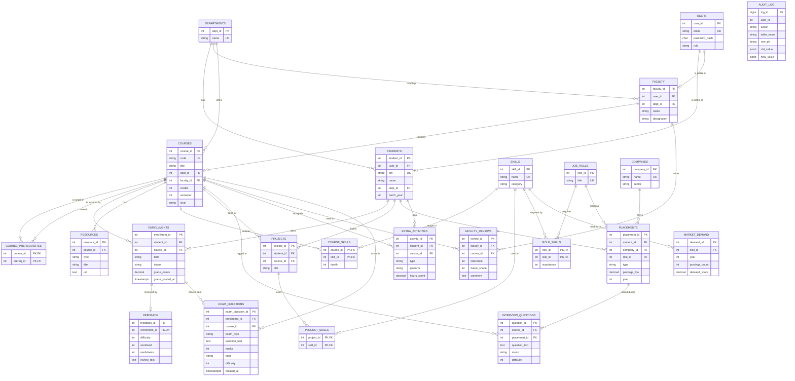

# ER diagram (PostgreSQL)

Render this file on GitHub (Mermaid is built in) or paste the block into https://mermaid.live to export an image.
Crow's-foot notation: `||` exactly one, `o|` zero or one, `|{` one or many, `o{` zero or many.



`course_prerequisites` is the self-referencing many-to-many on `courses`. `audit_log` has no foreign keys on purpose: audit rows must survive deletion of the rows they describe.

## Neo4j graph model

```
(:Course {course_id, code, title, level}) -[:PREREQUISITE_OF]-> (:Course)
(:Course) -[:TEACHES {depth}]-> (:Skill {skill_id, name, category})
(:Role {role_id, title}) -[:REQUIRES {importance}]-> (:Skill)
(:Skill) -[:RELATED_TO {strength}]-> (:Skill)        <- owned by Neo4j
(:Skill) -[:IN_CLUSTER]-> (:Cluster {name})          <- owned by Neo4j
```
The first three relationship types and all course, skill and role nodes are mirrored from PostgreSQL (`npm run sync-graph`). `RELATED_TO` and `IN_CLUSTER` exist only in Neo4j.
